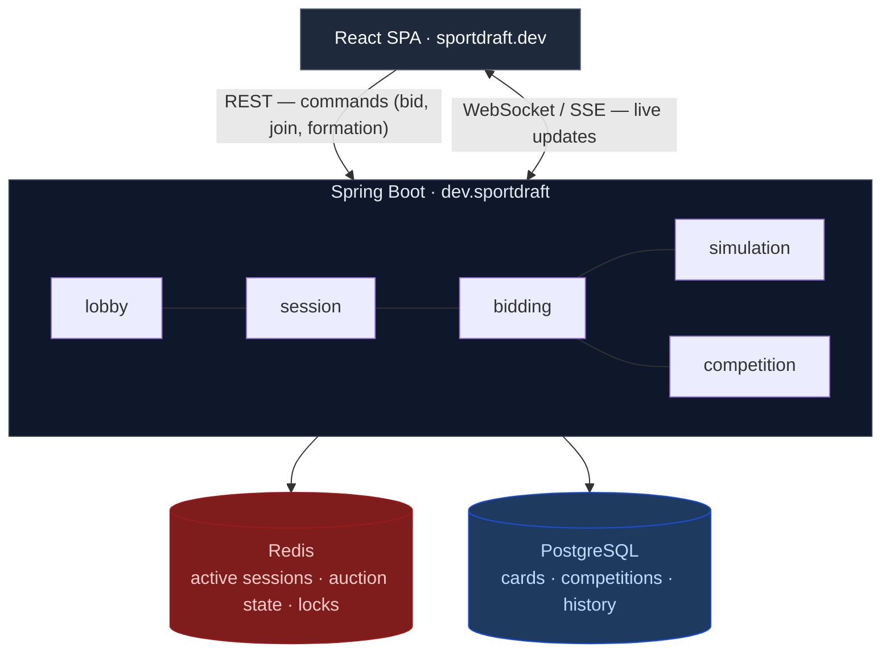

# SportDraft

**[Play at sportdraft.dev →](https://www.sportdraft.dev)**

Multiplayer football card auction draft. Two to four players share a card pool, bid from a **100-credit** budget, fill an **11-slot formation**, then the server runs an instant rating-based match simulation.


---

## Game modes

| Mode | Players | Flow |
|------|---------|------|
| **Duel** | 2 | Lobby → formation → auction draft → instant match result |
| **Tournament** | 4 | Shared draft → semi-finals → intermission → final |
| **League** | 4 | Shared draft → three matchdays → live table → co-champions or playoff final |

The host picks the **card pool** before the room opens: league (Premier League or Trendyol Super Lig) and minimum overall rating (**70 / 75 / 80**).

---

## How a session works

1. **Lobby** — create a room or join from the lobby list; countdown starts when the room is full.
2. **Formation** — each player picks a formation (e.g. 4-4-2, 4-3-3) before the draft.
3. **Auction draft** — sequential rounds; bid on cards that fit open roster slots. Budget, turn order, anti-snipe extension, and auto-pass rules are enforced server-side.
4. **Match** — when the draft finishes, the server simulates the fixture from card ratings and publishes the score (and event timeline for duels).

All game state is **server-authoritative**: clients send commands and render what the server sends back. Disconnect and reconnect are handled with a live event log.

---

## What's live today

- **Three game modes** — duel, tournament bracket, league season
- **Real-time updates** — WebSocket primary, SSE fallback
- **Spectator mode** — watch in-progress rooms from the lobby
- **Anonymous play** — no account required; session token in the browser
- **In-app feedback** — bug reports and suggestions from the lobby
- **Card pools** — Premier League and Trendyol Super Lig

Football only for now.

---

## Roadmap

### Next

- [ ] **User accounts** — OAuth sign-in instead of anonymous browser tokens
- [ ] **Basketball** — second sport mode
- [ ] **More card pools** — additional leagues and rating tiers
- [ ] **Abuse protection** — rate limits on bids, room creation, and feedback

### Planned

- [ ] **Match history & profiles** — browse past results and stats
- [ ] **Spectator improvements** — richer live view and replay UX
- [ ] **Full-draft E2E coverage** — automated end-to-end tests for complete 44-round drafts (smoke tests use shorter drafts today)
- [ ] **Multi-instance backend** — scheduler coordination when running more than one app replica

### Recently shipped

- Redis-backed live auction state (single aggregate per session)
- Room create/join flow (`createRoom` + `joinRoom`)
- Legacy API cleanup and schema migration (Flyway V26)

---

## For developers

This repo is the full stack for [sportdraft.dev](https://www.sportdraft.dev): Spring Boot API, React SPA, Docker Compose for local infra, GitHub Actions CI, Railway production deploy.

### Architecture



The backend is a **modular monolith**: feature slices (`lobby`, `session`, `bidding`, `simulation`, `competition`) each with boundary / control / entity layers. Active draft and auction state lives in **Redis**; Postgres holds the card catalog, competition brackets, and match history.

More detail: [docs/backend-architecture.md](docs/backend-architecture.md).

**API:** canonical surface is `/api/v2`. Legacy `/api` endpoints remain as a deprecated fallback.

### Stack

Java 21 · Spring Boot 3.3 · PostgreSQL 16 · Redis 7 · Flyway · React 18 · TypeScript · TanStack Query · Zustand · Tailwind · JUnit 5 · Testcontainers · Jest · Playwright

### Run locally

JDK 21, Node 20+, Docker.

```bash
cd infra && docker compose up -d
cd backend && mvn spring-boot:run -Dspring-boot.run.profiles=local
cd frontend && npm ci && npm start
```

Frontend defaults to `http://localhost:8080`. Override with `REACT_APP_API_BASE` in `frontend/.env`.

```
backend/     API + domain logic
frontend/    web app
e2e/         Playwright smoke tests
infra/       docker-compose (Postgres + Redis)
```

### Tests & CI

Every push runs backend (`mvn verify` with Testcontainers, JaCoCo line coverage gate at 85%), frontend (`npm run test:coverage`), and Playwright smoke tests for all three game modes.

```bash
cd backend && mvn verify          # needs Docker
cd backend && mvn test -Pskip-it    # unit tests only
cd frontend && npm run test:coverage
cd e2e && npm test                # Playwright (app must be running)
```

---

## License

**Proprietary** — source is published for transparency; reading the code does not grant a license to use, copy, or redistribute it. See [LICENSE](LICENSE).

Football player names, ratings, and club data may be subject to third-party rights; this project does not grant rights to redistribute that data.

Copyright © 2026 [Umut Guney Koksal](https://github.com/umutguneykoksal). For permissions, contact via GitHub.
